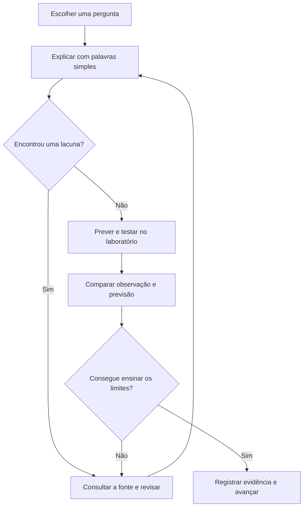

<div align="center">

# ToolsGuide
### Entenda a ferramenta. Questione a saída. Ensine o raciocínio.

**CYBER · OSINT · CTI · OFFSEC**

Guias em português para humanos e agentes de IA, com laboratório, narrativa e evidência.

[Comece aqui](docs/SETUP.md) · [Método](docs/METHOD.md) · [Caso Aurora](docs/AURORA.md) · [Contrato para IA](AGENTS.md)

</div>

## Entre na operação Aurora

08h17. Uma cooperativa fictícia recebe um relato sobre um domínio parecido com sua marca. Você acompanha Lia, analista responsável por separar observações de conclusões. A missão não termina quando um comando funciona: termina quando outra pessoa consegue entender e reproduzir seu raciocínio.

**Primeira entrega:** seis guias iniciais, seis laboratórios pequenos e um painel local com busca, filtros, caderno de estudo, progressão e exportação. Não é uma coleção completa de ferramentas nem certificação profissional.

## Abra seu painel

```sh
git clone https://github.com/Ridd1kulusC0d3r/ToolsGuide.git
cd ToolsGuide
python3 scripts/make_pcap.py
python3 -m http.server 8765 --bind 127.0.0.1
```

Abra **http://127.0.0.1:8765/**. O painel usa o catálogo local e não executa comandos. O progresso fica neste navegador; exporte seu caderno antes de limpar os dados. Sem contas, telemetria ou dependências de CDN. GitHub Pages ainda não está configurado.

## Escolha sua pergunta

| Missão | Ferramenta | Área | Entrega |
|---|---|---|---|
| Quais registros respondem à pergunta? | [jq](guides/jq.md) | CTI | Filtro reproduzível |
| O servidor respondeu ou a conexão falhou? | [curl](guides/curl.md) | Cyber | Corpo e cabeçalhos |
| O que o arquivo declara? | [ExifTool](guides/exiftool.md) | OSINT | Metadados com ressalvas |
| Qual nome foi consultado? | [TShark](guides/tshark.md) | Cyber | Leitura de captura sintética |
| A regra distingue os controles? | [YARA](guides/yara.md) | CTI | Hipótese e teste negativo |
| A porta local aceita conexão? | [Nmap](guides/nmap.md) | Offsec | Estado observado da porta |

## Aprender em ciclos



## Para agentes de IA

Leia [AGENTS.md](AGENTS.md), [llms.txt](llms.txt) e [catalog.json](catalog.json). Cada guia tem entrada, comando, saída esperada, limites, pré-requisitos e fonte. O catálogo é a fonte do painel; os guias aprofundam o raciocínio. Nenhuma saída simulada deve ser apresentada como resultado executado.

## Evolução editorial

Próximas trilhas propostas: CyberChef e OpenRefine para transformação; Sigma para detecção; MISP e OpenCTI para contexto; OWASP ZAP em laboratório para aplicações. São propostas, não módulos disponíveis. Novos guias entram com fixture, controle negativo, fonte primária e revisão técnica: [como contribuir](CONTRIBUTING.md).

**Qualidade verificável:** [validação e limites](docs/VALIDATION.md) · [modelo de guia](templates/guide.md) · [registro de evidência](templates/evidence.md).
