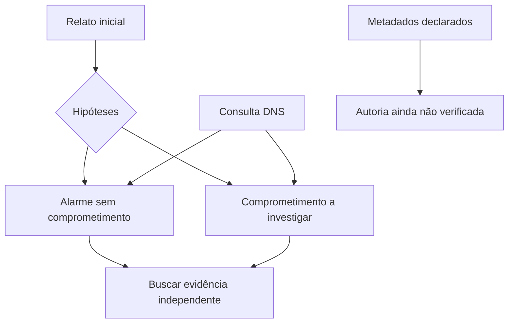

# Caso Aurora · 08h17, uma hipótese na mesa

**Todo o caso é fictício.** A cooperativa, os arquivos, os scores e os eventos foram criados para estudo. Os domínios `.example` e endereços de documentação não são IOCs reais. A captura é gerada sem acesso à rede.

## Ato I — O relato

Lia recebe um pequeno feed e a frase “este domínio prova que fomos comprometidos”. Sua primeira decisão é transformar a afirmação em perguntas: de onde veio o dado? O que foi observado? O que falta para sustentar comprometimento?

Use jq para selecionar os domínios e curl para entender a entrega de um arquivo via HTTP local. O score é um campo fictício de fornecedor, não probabilidade calibrada.

## Ato II — As pistas discordam

O SVG declara uma autoria; uma captura contém uma consulta DNS. Use ExifTool e TShark. Não una automaticamente o autor declarado, a origem IP e uma pessoa. Os artefatos foram preparados separadamente e não comprovam uma sequência causal real.

## Ato III — Uma regra não é um veredito

Use YARA para distinguir duas amostras benignas. Altere uma condição em cópia e documente o efeito no controle negativo. Depois use Nmap para observar a porta do seu serviço local antes e depois de encerrá-lo.

## Entrega final

Preencha uma página com: pergunta, fontes, versões, observações, duas hipóteses alternativas, lacunas e próxima coleta justificável. A conclusão aceitável é limitada: “A fixture contém uma consulta DNS ao nome indicado; não há nesta captura evidência de conexão HTTP nem de comprometimento”.

**Desafio de transferência:** qual evidência adicional seria necessária para diferenciar consulta automatizada, navegação humana e resolução feita por uma ferramenta de segurança? Explique como evitar atribuição precipitada.
