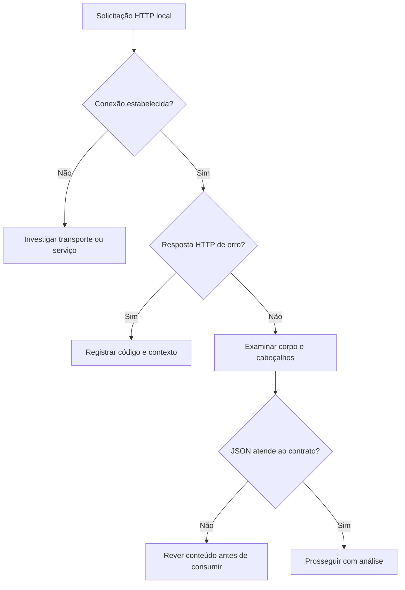

# curl · Converse com um serviço

[← Início](../README.md) · Cyber · 25 minutos · Nível inicial

## 1. A pergunta antes do comando

Lia precisa obter o feed do servidor de treinamento. O serviço responde, mas ela precisa distinguir falha de transporte, código HTTP e conteúdo JSON antes de entregar o material ao analista.

**Missão:** produzir corpo json e cabeçalhos separados. Pré-requisitos: Terminal, HTTP básico.

## 2. Explique como se ensinasse alguém

Um mensageiro que entrega uma solicitação e traz a resposta e seu envelope HTTP. Receber uma resposta HTTP não prova que seu conteúdo é verdadeiro ou que o serviço é seguro.

Feche este guia e explique a ideia em duas frases. Identifique uma palavra que você não consegue explicar sem recorrer a outra palavra técnica. Volte à documentação dessa palavra e reescreva sua explicação.



## 3. Prepare o laboratório

Consulte [ambiente e instalação](../docs/SETUP.md). Registre a versão com `curl --version`. Em outro terminal, na raiz do repositório: `python3 -m http.server 8765 --bind 127.0.0.1`. Encerre com Ctrl+C ao terminar.

Entrada: **Servidor local de treinamento**. Os dados da Aurora são fictícios e não são indicadores operacionais.

## 4. Preveja, execute e interprete

Antes de executar, anote sua previsão e a evidência que a faria mudar.

```sh
curl --fail --silent --show-error --max-time 5 --dump-header /tmp/aurora-headers.txt http://127.0.0.1:8765/labs/aurora/indicators.json
```

--fail sinaliza erros HTTP a partir de 400; --silent remove o medidor; --show-error preserva mensagens de erro; --max-time limita a duração; --dump-header separa cabeçalhos do corpo.

**Resultado esperado, não transcrição de execução:** JSON com três indicadores; cabeçalhos HTTP gravados em /tmp/aurora-headers.txt.

Registre comando, versão, momento da execução, saída e interpretação em [um registro de evidência](../templates/evidence.md). Separe o que a ferramenta mostrou da hipótese que você formulou.

## 5. Quebre a hipótese

Troque o caminho por /nao-existe. Diferencie HTTP 404 de connection refused.

<details><summary>Abra depois de tentar — raciocínio esperado</summary>

404 é resposta de um servidor alcançado. Connection refused ocorre antes de uma resposta HTTP; neste laboratório, confira se o servidor está ativo.

</details>

## 6. Quando não funciona

Connection refused: inicie o servidor local. Porta ocupada: encerre o serviço que você iniciou ou escolha outra porta e atualize o comando. Não use -k para esconder erros TLS.

## 7. Ensine de volta

Sem copiar: explique a ferramenta, cada parte relevante do comando, um resultado enganoso e uma verificação independente. Sua explicação deve incluir: **Receber uma resposta HTTP não prova que seu conteúdo é verdadeiro ou que o serviço é seguro.**

Use a [rubrica de domínio](../docs/METHOD.md). O painel registra autoavaliação; ele não certifica competência.

## 8. Próxima missão

Continue com [exiftool ](exiftool.md) e explique qual informação essa próxima ferramenta acrescenta.

## Fonte e estado da validação

[Documentação oficial](https://curl.se/docs/manpage.html) · revisão de referência: 2026-10-15.

Consulte [VALIDATION.md](../docs/VALIDATION.md) para versões executadas e limitações. Saídas acima são expectativas didáticas e podem variar entre ambientes.
