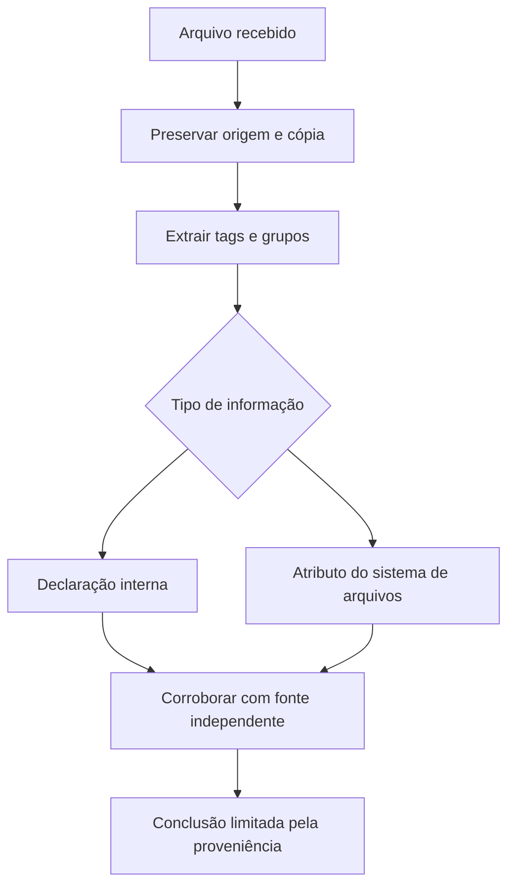

# ExifTool · Questione a etiqueta

[← Início](../README.md) · OSINT · 30 minutos · Nível inicial

## 1. A pergunta antes do comando

Um arquivo SVG chega com uma descrição afirmando ser material da Aurora. Lia precisa registrar o que o arquivo contém sem transformar essa declaração em autoria comprovada.

**Missão:** produzir metadados observados em json. Pré-requisitos: Arquivos e diretórios, Diferença entre observação e inferência.

## 2. Explique como se ensinasse alguém

Ler a etiqueta de uma caixa antes de confiar na história sobre seu conteúdo. Etiquetas podem ser alteradas ou removidas; metadados não autenticam autoria, local ou data de um evento.

Feche este guia e explique a ideia em duas frases. Identifique uma palavra que você não consegue explicar sem recorrer a outra palavra técnica. Volte à documentação dessa palavra e reescreva sua explicação.



## 3. Prepare o laboratório

Consulte [ambiente e instalação](../docs/SETUP.md). Registre a versão com `exiftool -ver`. Os arquivos necessários estão em `labs/aurora/`. Trabalhe na raiz do repositório.

Entrada: **labs/aurora/poster.svg**. Os dados da Aurora são fictícios e não são indicadores operacionais.

## 4. Preveja, execute e interprete

Antes de executar, anote sua previsão e a evidência que a faria mudar.

```sh
exiftool -j -G1 -s labs/aurora/poster.svg
```

-j produz JSON; -G1 identifica grupos de metadados; -s usa nomes curtos de tags. Sem opções de atribuição, a operação é de leitura.

**Resultado esperado, não transcrição de execução:** Array JSON com SourceFile e campos reconhecidos do SVG e do sistema de arquivos. Campos exatos e timestamps variam por versão e ambiente.

Registre comando, versão, momento da execução, saída e interpretação em [um registro de evidência](../templates/evidence.md). Separe o que a ferramenta mostrou da hipótese que você formulou.

## 5. Quebre a hipótese

Compare Description com FileModifyDate. Qual deles comprova a data em que um evento ocorreu?

<details><summary>Abra depois de tentar — raciocínio esperado</summary>

Nenhum isoladamente. Description é conteúdo declarado; FileModifyDate descreve o arquivo no sistema e pode mudar ao copiar. Precisamos de fontes independentes e proveniência.

</details>

## 6. Quando não funciona

Nenhuma tag GPS é esperada neste SVG. Ausência de GPS não indica ocultação deliberada. Tags de escrita alteram a evidência: trabalhe sobre cópias se estudar edição.

## 7. Ensine de volta

Sem copiar: explique a ferramenta, cada parte relevante do comando, um resultado enganoso e uma verificação independente. Sua explicação deve incluir: **Etiquetas podem ser alteradas ou removidas; metadados não autenticam autoria, local ou data de um evento.**

Use a [rubrica de domínio](../docs/METHOD.md). O painel registra autoavaliação; ele não certifica competência.

## 8. Próxima missão

Continue com [tshark ](tshark.md) e explique qual informação essa próxima ferramenta acrescenta.

## Fonte e estado da validação

[Documentação oficial](https://exiftool.org/exiftool_pod2.html) · revisão de referência: 2026-10-15.

Consulte [VALIDATION.md](../docs/VALIDATION.md) para versões executadas e limitações. Saídas acima são expectativas didáticas e podem variar entre ambientes.
