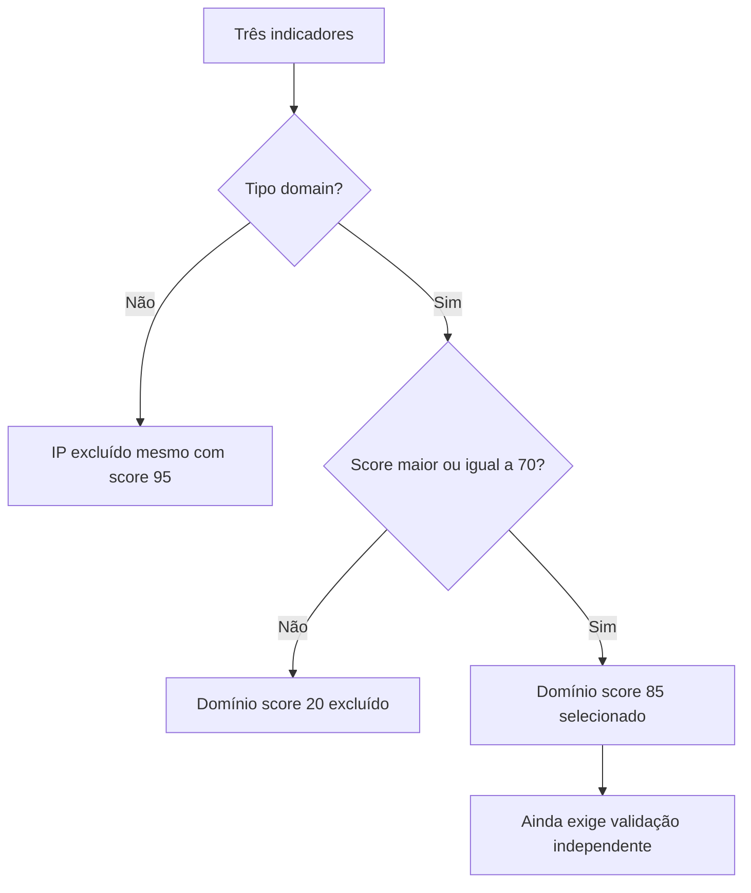

# jq · Separe sinal de ruído

[← Início](../README.md) · CTI · 25 minutos · Nível inicial

## 1. A pergunta antes do comando

Lia recebe três indicadores da cooperativa fictícia Aurora. O briefing pede apenas domínios com score do fornecedor acima de 70. Um endereço IP tem score maior, mas não responde à pergunta.

**Missão:** produzir lista textual filtrada; não é um veredito. Pré-requisitos: Terminal, JSON: objetos e listas.

## 2. Explique como se ensinasse alguém

Uma peneira de fichas: você escolhe quais campos e registros passam. A peneira não verifica a veracidade das fichas. Um score alto no feed não confirma uma ameaça.

Feche este guia e explique a ideia em duas frases. Identifique uma palavra que você não consegue explicar sem recorrer a outra palavra técnica. Volte à documentação dessa palavra e reescreva sua explicação.



## 3. Prepare o laboratório

Consulte [ambiente e instalação](../docs/SETUP.md). Registre a versão com `jq --version`. Os arquivos necessários estão em `labs/aurora/`. Trabalhe na raiz do repositório.

Entrada: **labs/aurora/indicators.json**. Os dados da Aurora são fictícios e não são indicadores operacionais.

## 4. Preveja, execute e interprete

Antes de executar, anote sua previsão e a evidência que a faria mudar.

```sh
jq -r '.indicators[] | select(.type == "domain" and .score >= 70) | .value' labs/aurora/indicators.json
```

.indicators[] percorre os registros; select mantém os que satisfazem ambas as condições; .value extrai o valor; -r remove as aspas de strings.

**Resultado esperado, não transcrição de execução:** login.aurora.example

Registre comando, versão, momento da execução, saída e interpretação em [um registro de evidência](../templates/evidence.md). Separe o que a ferramenta mostrou da hipótese que você formulou.

## 5. Quebre a hipótese

Mude o limiar para 95. Por que nenhum resultado não significa ausência de ameaça?

<details><summary>Abra depois de tentar — raciocínio esperado</summary>

Nenhum domínio da amostra satisfaz esse limiar. O filtro limita a visibilidade e a amostra não representa o universo de ameaças.

</details>

## 6. Quando não funciona

Cannot iterate over null: confira a chave indicators. Resultado vazio: confira tipos, limiar e estrutura antes de concluir que não há dados.

## 7. Ensine de volta

Sem copiar: explique a ferramenta, cada parte relevante do comando, um resultado enganoso e uma verificação independente. Sua explicação deve incluir: **A peneira não verifica a veracidade das fichas. Um score alto no feed não confirma uma ameaça.**

Use a [rubrica de domínio](../docs/METHOD.md). O painel registra autoavaliação; ele não certifica competência.

## 8. Próxima missão

Continue com [curl ](curl.md) e explique qual informação essa próxima ferramenta acrescenta.

## Fonte e estado da validação

[Documentação oficial](https://jqlang.org/manual/) · revisão de referência: 2026-10-15.

Consulte [VALIDATION.md](../docs/VALIDATION.md) para versões executadas e limitações. Saídas acima são expectativas didáticas e podem variar entre ambientes.
