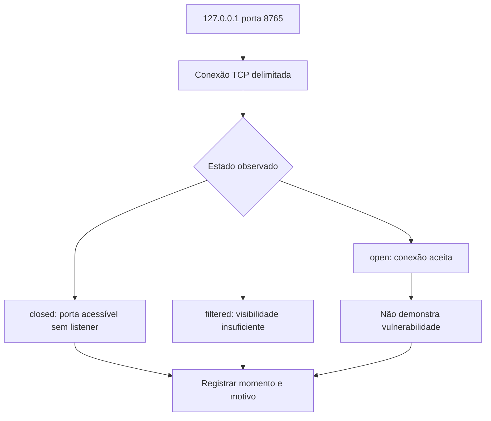

# Nmap · Teste uma porta, não uma crença

[← Início](../README.md) · Offsec · 30 minutos · Nível inicial

## 1. A pergunta antes do comando

A Aurora autorizou apenas o serviço local de treinamento. Lia confirma se a porta do laboratório aceita conexão; ela não precisa explorar o serviço para responder a essa pergunta.

**Missão:** produzir estado observado da porta tcp. Pré-requisitos: TCP e portas, Escopo autorizado.

## 2. Explique como se ensinasse alguém

Tocar a campainha de uma porta específica e anotar como ela respondeu. Uma porta aberta não é uma vulnerabilidade. O resultado depende do ponto de observação e do momento.

Feche este guia e explique a ideia em duas frases. Identifique uma palavra que você não consegue explicar sem recorrer a outra palavra técnica. Volte à documentação dessa palavra e reescreva sua explicação.



## 3. Prepare o laboratório

Consulte [ambiente e instalação](../docs/SETUP.md). Registre a versão com `nmap --version`. Em outro terminal, na raiz do repositório: `python3 -m http.server 8765 --bind 127.0.0.1`. Encerre com Ctrl+C ao terminar.

Entrada: **127.0.0.1:8765, serviço próprio**. Os dados da Aurora são fictícios e não são indicadores operacionais.

## 4. Preveja, execute e interprete

Antes de executar, anote sua previsão e a evidência que a faria mudar.

```sh
nmap -sT -Pn -p 8765 --reason 127.0.0.1
```

-sT usa conexão TCP; -Pn dispensa descoberta prévia; -p restringe a uma porta; --reason mostra o motivo do estado. O único alvo é loopback.

**Resultado esperado, não transcrição de execução:** 8765/tcp open enquanto o servidor local estiver ativo; closed após encerrá-lo. O rótulo de serviço pode variar e não identifica a aplicação com certeza.

Registre comando, versão, momento da execução, saída e interpretação em [um registro de evidência](../templates/evidence.md). Separe o que a ferramenta mostrou da hipótese que você formulou.

## 5. Quebre a hipótese

Encerre seu servidor local com Ctrl+C e repita. Por que open e closed podem estar corretos?

<details><summary>Abra depois de tentar — raciocínio esperado</summary>

São observações em momentos distintos. A primeira encontra um serviço ouvindo; a segunda encontra a porta sem esse serviço. filtered representa outra situação de visibilidade.

</details>

## 6. Quando não funciona

Resultado open inesperado: outro processo pode estar ouvindo. Não amplie o alvo para uma rede pública para tentar corrigir um problema de laboratório.

## 7. Ensine de volta

Sem copiar: explique a ferramenta, cada parte relevante do comando, um resultado enganoso e uma verificação independente. Sua explicação deve incluir: **Uma porta aberta não é uma vulnerabilidade. O resultado depende do ponto de observação e do momento.**

Use a [rubrica de domínio](../docs/METHOD.md). O painel registra autoavaliação; ele não certifica competência.

## 8. Próxima missão

Continue com [jq ](jq.md) e explique qual informação essa próxima ferramenta acrescenta.

## Fonte e estado da validação

[Documentação oficial](https://nmap.org/book/man.html) · revisão de referência: 2026-10-15.

Consulte [VALIDATION.md](../docs/VALIDATION.md) para versões executadas e limitações. Saídas acima são expectativas didáticas e podem variar entre ambientes.
