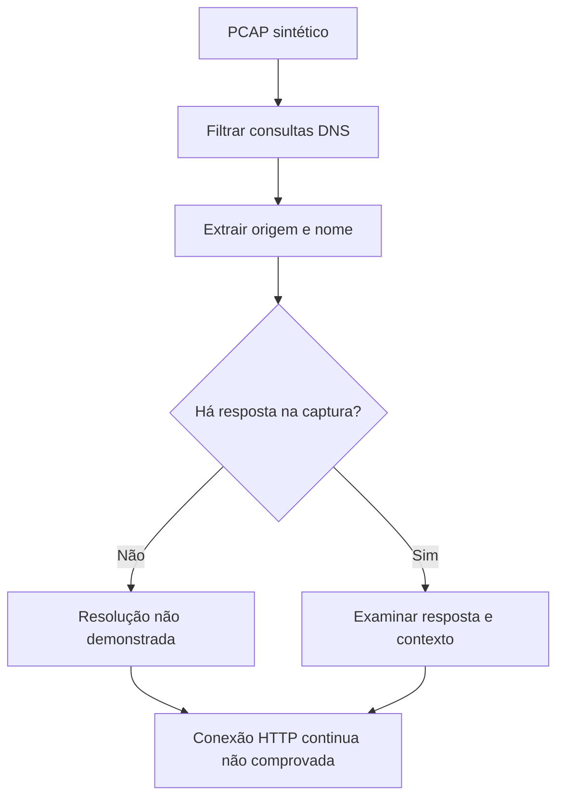

# TShark · Leia uma conversa em pacotes

[← Início](../README.md) · Cyber · 35 minutos · Nível inicial

## 1. A pergunta antes do comando

A equipe entrega uma captura sintética de uma única consulta DNS. Lia deve extrair a pergunta sem capturar tráfego real e sem atribuir o comportamento a uma pessoa.

**Missão:** produzir origem ipv4 e nome consultado. Pré-requisitos: IP e UDP, DNS básico.

## 2. Explique como se ensinasse alguém

Um leitor de envelopes de uma conversa: mostra quem perguntou o quê dentro do que foi registrado. Uma captura é uma janela parcial. DNS consultado não prova visita, comprometimento ou identidade humana.

Feche este guia e explique a ideia em duas frases. Identifique uma palavra que você não consegue explicar sem recorrer a outra palavra técnica. Volte à documentação dessa palavra e reescreva sua explicação.



## 3. Prepare o laboratório

Consulte [ambiente e instalação](../docs/SETUP.md). Registre a versão com `tshark --version`. Gere a captura: `python3 scripts/make_pcap.py`.

Entrada: **labs/aurora/dns.pcap**. Os dados da Aurora são fictícios e não são indicadores operacionais.

## 4. Preveja, execute e interprete

Antes de executar, anote sua previsão e a evidência que a faria mudar.

```sh
tshark -r labs/aurora/dns.pcap -Y 'dns.flags.response == 0' -T fields -e ip.src -e dns.qry.name
```

-r lê a captura existente; -Y aplica filtro de exibição; -T fields seleciona saída tabular; -e escolhe campos. Não exige captura ao vivo.

**Resultado esperado, não transcrição de execução:** 192.0.2.10	login.aurora.example

Registre comando, versão, momento da execução, saída e interpretação em [um registro de evidência](../templates/evidence.md). Separe o que a ferramenta mostrou da hipótese que você formulou.

## 5. Quebre a hipótese

A captura contém resposta DNS? É possível afirmar que houve conexão HTTP?

<details><summary>Abra depois de tentar — raciocínio esperado</summary>

Não há resposta na fixture, apenas uma pergunta DNS. Não há evidência de HTTP; seria necessário capturar ou obter eventos adicionais.

</details>

## 6. Quando não funciona

Saída vazia: confira o protocolo e o filtro. Filtros de captura e de exibição usam sintaxes diferentes. A fixture usa endereços de documentação e não representa incidente real.

## 7. Ensine de volta

Sem copiar: explique a ferramenta, cada parte relevante do comando, um resultado enganoso e uma verificação independente. Sua explicação deve incluir: **Uma captura é uma janela parcial. DNS consultado não prova visita, comprometimento ou identidade humana.**

Use a [rubrica de domínio](../docs/METHOD.md). O painel registra autoavaliação; ele não certifica competência.

## 8. Próxima missão

Continue com [yara ](yara.md) e explique qual informação essa próxima ferramenta acrescenta.

## Fonte e estado da validação

[Documentação oficial](https://www.wireshark.org/docs/man-pages/tshark.html) · revisão de referência: 2026-10-15.

Consulte [VALIDATION.md](../docs/VALIDATION.md) para versões executadas e limitações. Saídas acima são expectativas didáticas e podem variar entre ambientes.
