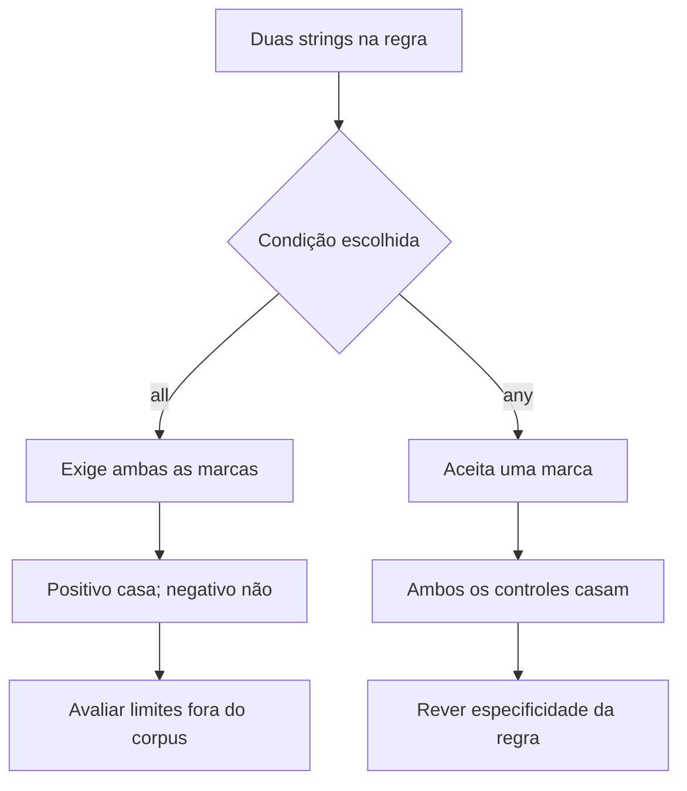

# YARA · Crie uma hipótese verificável

[← Início](../README.md) · CTI · 35 minutos · Nível inicial

## 1. A pergunta antes do comando

Dois textos benignos estão na mesa. Um contém o marcador de exercício e a frase escolhida; outro compartilha apenas parte do contexto. Lia precisa verificar o controle negativo antes de confiar no resultado.

**Missão:** produzir correspondências de uma regra didática. Pré-requisitos: Strings, Condições booleanas.

## 2. Explique como se ensinasse alguém

Um gabarito que procura uma combinação de marcas em arquivos. Encontrar marcas significa satisfazer a regra, não comprovar malware ou atribuir autoria.

Feche este guia e explique a ideia em duas frases. Identifique uma palavra que você não consegue explicar sem recorrer a outra palavra técnica. Volte à documentação dessa palavra e reescreva sua explicação.



## 3. Prepare o laboratório

Consulte [ambiente e instalação](../docs/SETUP.md). Registre a versão com `yara --version`. Os arquivos necessários estão em `labs/aurora/`. Trabalhe na raiz do repositório.

Entrada: **Regra e duas amostras benignas**. Os dados da Aurora são fictícios e não são indicadores operacionais.

## 4. Preveja, execute e interprete

Antes de executar, anote sua previsão e a evidência que a faria mudar.

```sh
yara labs/aurora/training.yar labs/aurora/samples/
```

A regra exige duas strings com all of them. A pasta contém apenas textos inertes; o nome positive descreve o resultado esperado do teste, não um arquivo malicioso.

**Resultado esperado, não transcrição de execução:** Aurora_Training labs/aurora/samples/positive.txt (a apresentação do caminho pode variar). Nenhum match em negative.txt.

Registre comando, versão, momento da execução, saída e interpretação em [um registro de evidência](../templates/evidence.md). Separe o que a ferramenta mostrou da hipótese que você formulou.

## 5. Quebre a hipótese

Troque all of them por any of them em uma cópia. O controle negativo passa a casar? O que isso ensina?

<details><summary>Abra depois de tentar — raciocínio esperado</summary>

Sim: negative.txt contém o marcador compartilhado. Relaxar a condição amplia cobertura e também falsos positivos. Esse corpus mínimo não mede desempenho em produção.

</details>

## 6. Quando não funciona

Syntax error: confira aspas, chaves e a seção condition. Zero matches: confira maiúsculas e bytes das strings. Não rotule um arquivo como malware com base nesta regra didática.

## 7. Ensine de volta

Sem copiar: explique a ferramenta, cada parte relevante do comando, um resultado enganoso e uma verificação independente. Sua explicação deve incluir: **Encontrar marcas significa satisfazer a regra, não comprovar malware ou atribuir autoria.**

Use a [rubrica de domínio](../docs/METHOD.md). O painel registra autoavaliação; ele não certifica competência.

## 8. Próxima missão

Continue com [nmap ](nmap.md) e explique qual informação essa próxima ferramenta acrescenta.

## Fonte e estado da validação

[Documentação oficial](https://yara.readthedocs.io/en/stable/writingrules.html) · revisão de referência: 2026-10-15.

Consulte [VALIDATION.md](../docs/VALIDATION.md) para versões executadas e limitações. Saídas acima são expectativas didáticas e podem variar entre ambientes.
